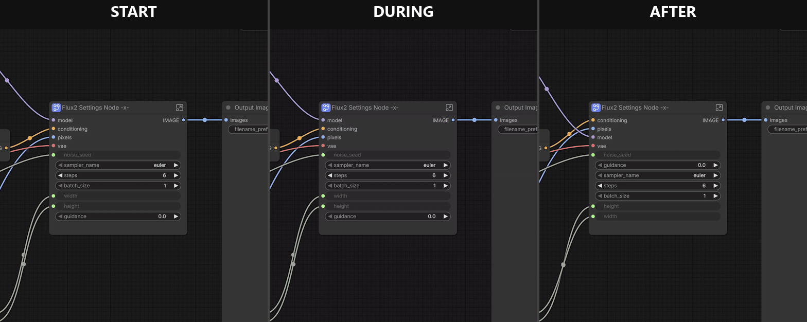

# Subgraph IO Organizer

> I love using ComfyUI subgraphs to keep graphs neat. I hate having to get the input/output order correct the first time.

**But, what happens if you don't get it correct the first time? And, why should you have to?** 

**How do I rearrange the connection and widget ports on a ComfyUI subgraph?**

Install this, right-click the subgraph, and drag them where you want them.



Subgraph IO Organizer means you don't have to be correct from the start. Build the subgraph however it comes together, then tidy its ports in one dialog. Links stay connected, widget values stay with their widgets, and every copy of the subgraph in your workflow updates at once.

## What you get

- **Drag-and-drop ordering for all three port lists:** connections, widgets and outputs.
- **Every instance updated:** copies on the canvas and copies nested inside other subgraphs all change together, so they can't drift out of step.
- **Links that survive:** wires inside and outside the subgraph follow their ports to the new positions.
- **Values that survive:** a seed stays a seed and doesn't land in your step count.
- **Port removal in the same dialog:** mark the ports you no longer need and remove them in one pass.
- **One-step undo:** **Ctrl+Z** reverts the whole change, however many ports you moved.
- **Workflows anyone can open:** the result is an ordinary ComfyUI workflow. The extension adds no nodes, so people you share it with don't need to install anything.

## Why not use what's built in?

ComfyUI can reorder some of this, but not all of it. Compared with frontend 1.48.6:

| | Built-in panels | Subgraph IO Organizer |
|---|---|---|
| Reorder widgets | Yes | Yes |
| Reorder connection inputs | No | Yes |
| Reorder outputs | No | Yes |
| Update every instance of the subgraph | No, only the one you're editing | Yes |

## How to use it

1. Open the organizer in any of these ways:
   - Right-click a subgraph node and choose **Subgraph IO Organizer…**
   - Inside a subgraph, right-click the canvas and choose the same item.
   - Press **Alt+R** with a subgraph node selected or a subgraph open.
   - Go to **Extensions → Subgraph IO Organizer**.
2. Drag labels into the order you want. Long lists auto-scroll when you drag near the top or bottom edge.
3. Click ⊖ to mark a port for removal, or ↶ to keep it. Removed ports lose their links when you apply.
4. Click **Apply**. Each moved port shows its old position until then, and **Reset** puts everything back.

It also works from the keyboard. Click or Tab to a label, press **Alt+↑/↓** to move it and **Delete** to mark it for removal. **Esc** deselects, and pressing it again closes the dialog.

### Why connections and widgets are separate

ComfyUI always draws connection ports above widgets on a subgraph node, whatever their internal order. The organizer shows them as two groups, so what you see in the dialog is what you get on the node. Each group reorders within itself.

Reordering outputs changes which inputs a bypassed instance passes through, because ComfyUI pairs them by position.

## Install

**ComfyUI Manager:** search for **Subgraph IO Organizer** and install it.

**comfy-cli:**

```
comfy node install subgraph-io-organizer
```

**Manually:**

```
cd ComfyUI/custom_nodes
git clone https://github.com/chridictions/ComfyUI-subgraph_io_organizer
```

Restart ComfyUI, then hard-refresh your browser.

## Requirements

ComfyUI 0.31.0 or newer with frontend 1.48.6 or newer. The extension was built against those versions, and subgraph internals can change between frontend releases. If a newer version misbehaves, please [open an issue](https://github.com/chridictions/ComfyUI-subgraph_io_organizer/issues).

Apply reloads the workflow, which affects some other packs:

- **Impact Pack:** use a version released after 2026-10-29. Older versions can rewire Switch nodes when the workflow reloads.
- **rgthree:** choosing **Fix in place** after Apply resets the undo history, so **Ctrl+Z** can't revert the Apply.

## How it works

When you click **Apply**, the browser sends the current workflow to your own ComfyUI server. The server rewrites the slot positions in the subgraph definition, its internal links, every instance and their external links, then the result reloads into the same tab. Nothing leaves your machine.

## Support

If Subgraph IO Organizer saves you some rewiring, you can [buy me a coffee on Ko-fi](https://ko-fi.com/chridictions).
